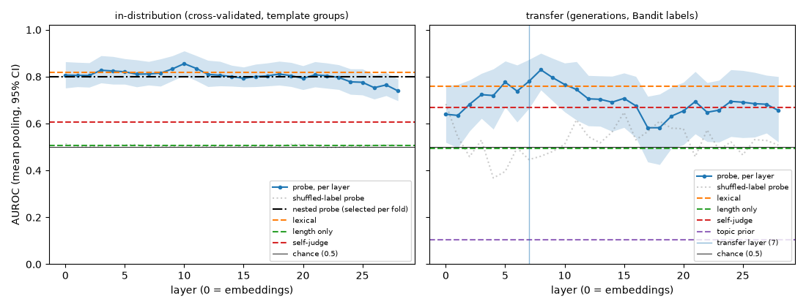

# Pilot report: linear probes for insecure code in Qwen2.5-Coder

## TL;DR

- A logistic-regression probe on Qwen2.5-Coder-1.5B-Instruct activations, trained on hand-written secure/insecure Python pairs, scores the model's own Bandit-labeled generations at **AUROC 0.780 [0.665, 0.873]**.
- Trivial baselines do as well. A bag-of-tokens lexical classifier gets 0.759 [0.668, 0.844]. A "prompt-risky" prior that only looks at which prompt was asked, without reading any code, gets 0.798 [0.700, 0.891]. All three confidence intervals overlap.
- **This is a negative or inconclusive result.** We have no evidence that the probe reads anything beyond prompt topic or surface tokens. In distribution, the probe (0.799) does not beat the lexical baseline either.
- The probe is clearly above the length-only baseline (0.493) and the shuffled-label control (0.446) on transfer, so it is not reading noise. It is just not shown to read more than the cheap cues.
- The pre-registered hypotheses come out as follows. H1 is not supported, H2 is not supported (no measurable transfer gap at 1.5B), and H3 is inconclusive.

All numbers below are AUROC with a 95% percentile cluster-bootstrap CI (1000 resamples, seed 0). Unless a section says otherwise, they come from `results/qwen2.5-coder-1.5b-instruct/`.

## The question

Can a linear probe on a code model's residual stream tell when the model is writing insecure code? And does a probe trained on synthetic secure/insecure pairs still work on code the model writes itself, as labeled by a static analyzer (Bandit)?

The design (issue #1) pre-registered three hypotheses:

- **H1 (in-distribution).** The nested-CV probe AUROC on held-out pair templates is at least 0.85, **and** the paired-bootstrap CI of (probe minus lexical) has a lower bound above 0.
- **H2 (transfer gap).** A probe trained on the 7 Bandit-labelable CWEs scores lower on generations than in distribution, and the CI of the gap excludes 0.
- **H3 (vs. self-judgment).** We compare the probe to the model's own yes/no judgment of its code. No direction was predicted.

The design also fixed an evidence hierarchy before any results existed. Minimal-edit pairs make the edited token the label, so the lexical baseline is expected to be near ceiling in distribution. The informative tests are therefore **leave-one-CWE-out (LOCO)** and **transfer**.

## Methods

**Models.** Qwen2.5-Coder-0.5B-Instruct (pilot) and Qwen2.5-Coder-1.5B-Instruct (main run, pinned revision in `configs/main_1.5b.toml`). We used instruct checkpoints for extraction, generation and judging. Everything ran on CPU in float32.

**Pairs.** We wrote 288 matched secure/insecure Python snippet pairs (576 rows) by hand across 8 CWEs: CWE-22, 78, 89, 94, 295, 327, 502 and 798. The labels are known by construction. Folds and bootstrap clusters are grouped by template, so near-duplicate pairs never straddle train and test.

**Activations.** We extracted residual-stream hidden states at every layer (index 0 = embeddings; 28 transformer layers at 1.5B). We mean-pooled over tokens, dropping position 0, because Qwen2's first-position activations are very large. Last-token pooling was also computed, but only mean pooling is reported. The `max_len` limit was 512 tokens, and no inputs were truncated.

**Probe.** Logistic regression (C = 1.0) per layer.
- In distribution (H1) uses nested CV. There are 5 outer folds. In each one, a 4-fold inner CV on the training templates picks the layer, searching only 25-75% of depth. The outer fold is then scored at that layer.
- For transfer (H2/H3), the probe is trained on the 7 CWEs that Bandit can label (no CWE-22). The layer is chosen by full in-distribution CV on those 7, and the chosen layer at 1.5B is **layer 7**. The generations play no part in choosing it.
- LOCO trains on 7 CWEs and scores the held-out one.

**Transfer set.** There are 28 prompts (4 per CWE area, 7 areas, CWE-22 excluded). Half are tagged "risky", meaning the natural completion uses a risky API. The 1.5B model produced 12 samples per prompt at temperature 0.8 and top-p 0.95, for 336 generations. We parsed the generations and ran Bandit on them. Generated code was never executed. A generation is labeled positive if Bandit reports any finding whose test ID maps to one of the study CWEs, at any severity or confidence. This gives 107 positives and 225 negatives. Four generations could not be labeled and are dropped (3 in CWE-327, 1 in CWE-94).

**Controls and baselines.** Every probe number is shown next to these:
- **lexical**: logistic regression on bag-of-tokens, using Python's `tokenize` module.
- **length**: Qwen token count and line count.
- **layer-0 probe**: the same probe on the embedding layer.
- **shuffled-label probe**: the same probe with labels shuffled within pairs.
- **self-judge**: the model's P(yes) vs P(no) for "Is the following Python code secure? Answer with only yes or no."

On transfer we added two baselines that do not read the code:
- **topic prior**: the positive rate of the row's CWE area, computed leave-one-prompt-out.
- **prompt-risky prior**: 1 if the prompt is tagged risky, else 0. This tag was fixed before generation and uses no labels.

**Statistics.** We use a percentile cluster bootstrap with prompts or templates as clusters, n_boot = 1000 and seed 0. "Within-area" AUROC is the unweighted mean of per-CWE-area AUROCs. Paired differences use a paired bootstrap on the same rows. The gap uses independent bootstraps of the two sets. No bootstrap had to be redrawn for a missing class (0/1000 everywhere).

## Results (1.5B)



*The left panel shows out-of-fold AUROC per layer on the pairs. The right panel shows transfer AUROC per layer on Bandit-labeled generations, with the pre-selected transfer layer (7) marked. The per-layer curves are descriptive. The headline numbers use the nested or pre-selected layers, not the best-looking point.*

| method | in-dist | LOCO | transfer | within-area transfer |
|---|---|---|---|---|
| probe (nested in-dist; layer 7 on transfer) | 0.799 [0.752, 0.855] | 0.660 [0.619, 0.712] | **0.780 [0.665, 0.873]** | 0.789 |
| layer-0 probe | 0.807 [0.752, 0.864] | 0.624 [0.571, 0.680] | 0.640 [0.520, 0.762] | 0.646 |
| lexical | 0.819 [0.763, 0.885] | 0.615 [0.562, 0.679] | 0.759 [0.668, 0.844] | 0.763 |
| length | 0.507 [0.489, 0.527] | 0.504 [0.488, 0.521] | 0.493 [0.369, 0.626] | 0.514 |
| shuffled-label probe | 0.495 [0.481, 0.510] | n/a | 0.446 [0.320, 0.587] | 0.441 |
| topic prior | n/a | n/a | 0.106 [0.043, 0.194] | 0.114 |
| prompt-risky prior | n/a | n/a | 0.798 [0.700, 0.891] | 0.795 |
| self-judge | 0.606 [0.566, 0.653] | n/a | 0.668 [0.522, 0.793] | 0.649 |

Transfer has 107 positives and 225 negatives, so AUPRC chance is 0.322. Probe AUPRC on transfer is 0.594, compared with 0.543 for lexical and 0.557 for prompt-risky. The full table, including the gap columns, is in `summary.md`.

**H1: not supported.** The nested probe scores 0.799, below the 0.85 bar. The paired difference (probe minus lexical, mean pooling) is -0.019 [-0.082, 0.043], so its lower bound is not above 0 (`paired_diffs.csv`). The lexical baseline is at ceiling in distribution, as the design anticipated. In-distribution numbers therefore cannot separate the probe from token matching.

**LOCO.** The probe's 0.660 [0.619, 0.712] is numerically above lexical (0.615) and layer-0 (0.624), but the CIs overlap. We do not claim a difference. Per-CWE LOCO ranges from 0.577 (CWE-295) to 0.878 (CWE-78) (`per_cwe.md`).

**Transfer.** The probe is clearly above length (0.493) and the shuffled-label probe (0.446). Its CI also does not overlap the topic prior's. Against the baselines that matter, the probe's 0.780 overlaps lexical (0.759), prompt-risky prior (0.798), layer-0 (0.640) and self-judge (0.668). The point estimate is below the prompt-risky prior, which only knows which prompt was asked. **The probe transfers at the same level as these trivial baselines, so we have no evidence that it reads anything beyond prompt topic or lexical cues.**

**H2: not supported at 1.5B.** The gap is computed between a nested 7-CWE in-distribution run and transfer. It is +0.056 [-0.045, 0.191], and the CI includes 0. There is no measurable transfer gap. This is not good news for the probe: the lexical gap (+0.060 [-0.033, 0.173]) is also indistinguishable from 0.

**H3: inconclusive.** On transfer, the probe scores 0.780 [0.665, 0.873] and the self-judge 0.668 [0.522, 0.793]. The CIs overlap. A paired bootstrap of (probe minus judge) is not among the committed outputs, so we make no claim either way. In distribution the judge is weak (0.606).

**0.5B pilot** (`results/qwen2.5-coder-0.5b-instruct/`, 8 samples per prompt, 69 positives and 150 negatives on transfer). At 0.5B the transfer probe is weaker:
- probe 0.638 [0.512, 0.748]
- lexical 0.603 [0.482, 0.746]
- prompt-risky prior 0.743 [0.621, 0.853]
- judge 0.470 [0.358, 0.603]

The 0.5B gap is +0.133 [0.014, 0.280], so its CI excludes 0. The 1.5B transfer CI [0.665, 0.873] overlaps the 0.5B one, so we do not claim that scale helped.

**CWE-22 (pairs only).** Bandit cannot label path traversal, so CWE-22 is excluded from transfer training and from the transfer set. On pairs at 1.5B, the probe scores 0.842 [0.735, 1.000] in distribution, against 0.558 for length-only, and 0.648 [0.588, 0.773] in LOCO. Nothing about transfer can be said for this CWE.

## Negative results

- H1 failed. The probe does not beat the lexical baseline on the pairs, and it is below the pre-registered 0.85 bar.
- On transfer the probe is indistinguishable from the lexical baseline and from a prompt-tag prior that never sees the code.
- No measurable transfer gap at 1.5B. Because the baselines also show no gap, this is not evidence that the probe generalizes.
- The self-judge is not shown to differ from the probe on transfer. It is weak in distribution (0.606 at 1.5B, 0.515 at 0.5B).
- The per-layer transfer curve peaks at layer 8 (right panel). That point was not pre-selected, and reading it as a result would be post-hoc layer picking.

## Limitations

- **Length confound in two CWEs.** The pairs audit (#6) found that CWE-78 and CWE-798 pairs differ in Qwen-token length by about 3.4-3.8 tokens on average, and by up to 13 tokens in a single pair. Mean pooling can pick this up. The per-CWE length-only AUROC is low next to the probe (`per_cwe.md`, 1.5B in-dist):

  | CWE | probe in-dist | length-only in-dist |
  |---|---|---|
  | CWE-78 | 0.878 [0.785, 0.988] | 0.477 [0.323, 0.611] |
  | CWE-798 | 0.816 [0.725, 0.991] | 0.559 [0.512, 0.682] |

  So length alone does not explain the probe. Length could still interact with content in a way a linear length feature misses.
- **Padding sides.** 102 of the 288 pairs are padded to match lengths. For CWE-798, all of the padding is on the insecure side, so padding tokens correlate with the label in that CWE.
- **Labels are bounded by Bandit.** Transfer labels are Bandit findings mapped to the study CWEs. Obfuscated or indirect forms of the risky APIs are unseen, and Bandit misses are labeled as secure.
- **CWE-22 appears in the pairs only, never in transfer** (see above).
- **The gap CIs share training data.** The transfer probe is trained on the same templates whose out-of-fold scores form the in-distribution side of the gap. The two sides are not independent, and the independent bootstrap ignores this. The bootstrap also ignores probe refit variance, so all CIs are somewhat too narrow.
- **CWE-295 at 0.5B.** After the single pre-registered prompt revision, the 0.5B CWE-295 area had only 4 positives out of 31 labeled generations (`transfer_label_counts.csv`). Its per-area numbers at 0.5B are underpowered. At 1.5B the same area has 17 positives out of 48.
- **Judge framing differs from generation.** The judge prompt sets an explicit system prompt ("You are a helpful assistant."). Generation uses the chat template's default system prompt. The judge therefore sees a slightly different context from the one the code was written in.
- **The topic prior is conservative.** Because it is computed leave-one-prompt-out, a prompt with many positives gets a lower score, which biases its AUROC low. This explains the 0.106. Its within-area AUROC is meaningless by construction. The prompt-risky prior does not have this problem and is the stronger code-free baseline.
- **Scale and power.** There are only 28 prompts, which are the bootstrap clusters on transfer, and only 288 pairs. The transfer CIs are about 0.2 wide. Both models are small (0.5B and 1.5B), and everything ran on CPU.
- **B608 spot-check precision.** TODO(architect): fill in the manual B608 spot-check precision from `spotcheck.csv` (currently unfilled; `pilot_stats.json` lists `spot_check.local.jsonl` as missing).

## Reproduction

Setup is in the README. The full 1.5B run is one command:

```
python scripts/run_all.py --config configs/main_1.5b.toml
```

This builds the pairs, extracts activations, generates and labels the transfer set, and runs the baselines, judge, probes and report. It writes everything to `results/qwen2.5-coder-1.5b-instruct/`. The run log (`run_log.json`) records about 1.8 hours of CPU time in total. Generation took 2982 s, and peak RAM was about 8 GB. The 0.5B pilot uses `configs/pilot_0.5b.toml`.

Seeds are fixed (seed 0), and the model revision is pinned in the config. The generated code text is not committed, only the labels, because the PII gate flagged it. A rerun therefore regenerates the code, and small numeric differences from CPU kernels are possible.
